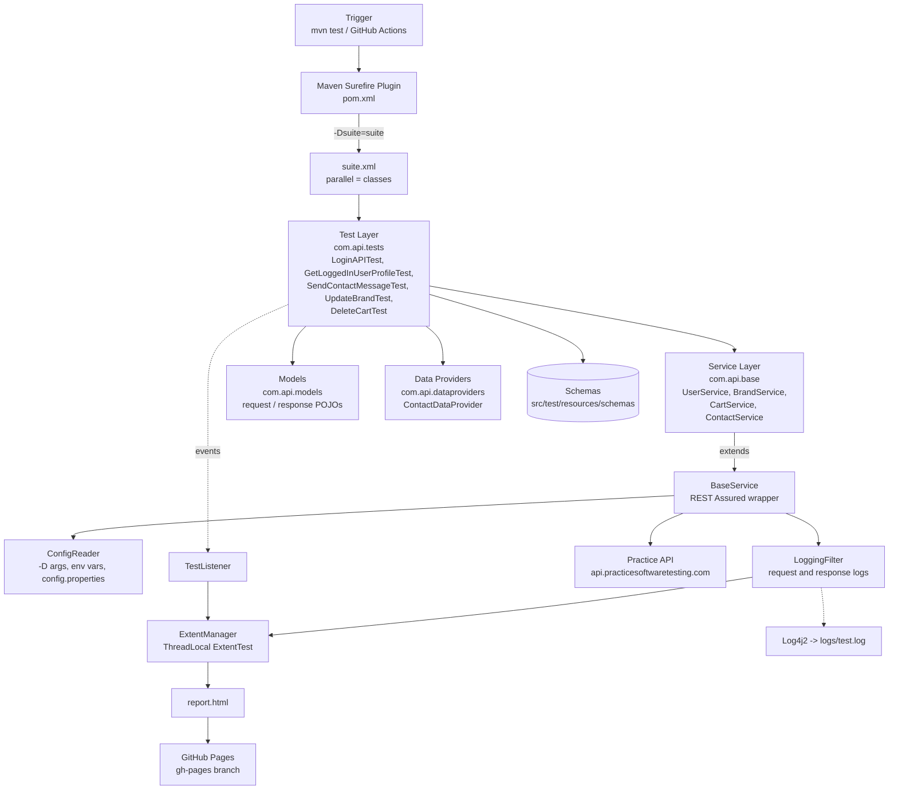

# API Automation Framework - Java, REST Assured, TestNG

 

[](#tech-stack)

[](#tech-stack)

[](#tech-stack)

[](https://github.com/Arun141/APIAutomationFramework/actions)

 

A Java-based API test automation framework built with REST Assured and TestNG. It uses a service-layer design with request and response models, JSON schema validation, data-driven tests, parallel execution, externalized configuration, logging with Log4j2, and HTML reporting with Extent Reports. It runs through GitHub Actions on every push, daily on a schedule, and on demand.

 

The tests run against the public practice API [api.practicesoftwaretesting.com](https://api.practicesoftwaretesting.com).

 

[View the latest test report](https://arun141.github.io/APIAutomationFramework/report.html)

 

---

 

## Table of Contents

 

- [Features](#features)

- [Tech Stack](#tech-stack)

- [Architecture](#architecture)

- [Folder Structure](#folder-structure)

- [Prerequisites](#prerequisites)

- [Getting Started](#getting-started)

- [Running Tests](#running-tests)

- [Configuration](#configuration)

- [Test Data and Schemas](#test-data-and-schemas)

- [Reports and Logs](#reports-and-logs)

- [CI/CD - GitHub Actions](#cicd---github-actions)

- [Author](#author)

 

---

 

## Features

 

- **Service layer:** `BaseService` wraps REST Assured. Each API area has its own service class (`UserService`, `BrandService`, `CartService`, `ContactService`).

- **Request and response models:** POJOs for payloads and responses, serialized and deserialized with Jackson.

- **JSON schema validation:** responses are checked against schemas stored in `src/test/resources/schemas`.

- **Data-driven testing:** TestNG `@DataProvider` feeds multiple data sets into a test.

- **Parallel execution:** TestNG runs test classes in parallel (`parallel="classes"`).

- **Externalized configuration:** `ConfigReader` reads values from `-D` arguments, environment variables, or `config.properties`, in that order.

- **Request and response logging:** a REST Assured `LoggingFilter` logs every call to Log4j2 and to the Extent report.

- **Listeners:** `TestListener` records test results and logs lifecycle events.

- **Reporting:** HTML reports with Extent Reports, with a per-test thread-safe entry that includes the request and response details.

- **CI/CD:** GitHub Actions runs the suite on push, on a daily schedule, and manually. The report is published to GitHub Pages.

 

---

 

## Tech Stack

 

| Area | Technology |

|---|---|

| Language | Java 11 |

| Build tool | Maven |

| API testing | REST Assured 5.3.0 |

| Test runner | TestNG 7.10.2 |

| Schema validation | REST Assured json-schema-validator 5.3.0 |

| JSON | Jackson 2.22.4 |

| Logging | Log4j2 2.26.1 |

| Reporting | Extent Reports 5.1.2 |

| CI/CD | GitHub Actions, GitHub Pages |

 

---

 

## Architecture

 



 

### Layers

 

| Layer | Package / Location | Responsibility |

|---|---|---|

| Test | `com.api.tests` | Test scenarios and assertions. |

| Service | `com.api.base` | One class per API area. `BaseService` builds requests and sends them. |

| Models | `com.api.models.request`, `com.api.models.response` | Request and response POJOs. |

| Data Providers | `com.api.dataproviders` | Feed multiple data sets to TestNG tests. |

| Filters | `com.api.filters` | `LoggingFilter` logs requests and responses. |

| Listeners | `com.api.listeners` | `TestListener` handles test lifecycle events and Extent entries. |

| Utilities | `com.api.utils` | `ConfigReader` and `ExtentManager`. |

| Schemas | `src/test/resources/schemas` | JSON schemas used for response validation. |

 

### Execution Flow

 

1. `mvn clean test -Dsuite=suite` is triggered locally or by GitHub Actions.

2. Surefire reads `suite.xml`, and TestNG runs test classes in parallel.

3. Each test creates its own service object. `BaseService` reads the base URL from `ConfigReader`.

4. The service sends the request. `LoggingFilter` logs it to Log4j2 and to the current test's Extent entry.

5. The test validates the response against a JSON schema and checks values with TestNG assertions.

6. `TestListener` records the result, and `report.html` is generated when the suite finishes.

7. In CI, the report is uploaded as an artifact and published to GitHub Pages.

 

---

 

## Folder Structure

 

```text

APIAutomationFramework

│

├── .github

│   └── workflows

│       └── maven.yml                  # GitHub Actions pipeline

│

├── src

│   └── test

│       ├── java

│       │   └── com

│       │       └── api

│       │           ├── base

│       │           │   ├── BaseService.java

│       │           │   ├── BrandService.java

│       │           │   ├── CartService.java

│       │           │   ├── ContactService.java

│       │           │   └── UserService.java

│       │           │

│       │           ├── dataproviders

│       │           │   └── ContactDataProvider.java

│       │           │

│       │           ├── filters

│       │           │   └── LoggingFilter.java

│       │           │

│       │           ├── listeners

│       │           │   └── TestListener.java

│       │           │

│       │           ├── models

│       │           │   ├── request

│       │           │   │   ├── BrandRequest.java

│       │           │   │   ├── LoginRequest.java

│       │           │   │   └── SendNewContactRequest.java

│       │           │   └── response

│       │           │       ├── LoginResponse.java

│       │           │       ├── NewBrandResponse.java

│       │           │       ├── SendNewContactResponse.java

│       │           │       ├── UserAddressResponse.java

│       │           │       └── UserProfileResponse.java

│       │           │

│       │           ├── tests

│       │           │   ├── DeleteCartTest.java

│       │           │   ├── GetLoggedInUserProfileTest.java

│       │           │   ├── LoginAPITest.java

│       │           │   ├── SendContactMessageTest.java

│       │           │   └── UpdateBrandTest.java

│       │           │

│       │           └── utils

│       │               ├── ConfigReader.java

│       │               └── ExtentManager.java

│       │

│       └── resources

│           ├── config.properties      # Base URL and credentials

│           ├── log4j2.xml             # Log4j2 configuration

│           └── schemas

│               ├── login-response-schema.json

│               └── send-contact-response-schema.json

│

├── .gitignore

├── pom.xml                            # Dependencies and Surefire config

├── suite.xml                          # TestNG suite definition

└── Readme.md

```

 

Generated at runtime:

 

```text

├── target/extent-report/report.html   # Extent HTML report

└── logs/test.log                      # Log file

```

 

---

 

## Prerequisites

 

- **Java 11:** `JAVA_HOME` must be set.

- **Maven:** it must be on your system `PATH`.

- **Internet access:** the tests call a public API.

 

Verify the setup:

 

```bash

java -version

mvn -version

```

 

---

 

## Getting Started

 

```bash

git clone https://github.com/Arun141/APIAutomationFramework.git

cd APIAutomationFramework

mvn clean compile

```

 

---

 

## Running Tests

 

### Run the full suite

 

```bash

mvn clean test -Dsuite=suite

```

 

The `-Dsuite` value is the name of the TestNG suite file without `.xml`. Without it, Surefire cannot find the suite.

 

### Override configuration at runtime

 

```bash

mvn clean test -Dsuite=suite -Dbase.url=https://api.practicesoftwaretesting.com

```

 

Add `-X` to any command for Maven debug output when troubleshooting.

 

### Run a single suite file

 

Create another suite file, for example `smoke.xml`, and run:

 

```bash

mvn clean test -Dsuite=smoke

```

 

---

 

## Configuration

 

| Source | Priority | Example |

|---|---|---|

| JVM argument | 1 (highest) | `-Dbase.url=https://...` |

| Environment variable | 2 | `BASE_URL`, `API_USERNAME`, `API_PASSWORD` |

| `src/test/resources/config.properties` | 3 (default) | `base.url=https://...` |

 

Keys in `config.properties`:

 

| Key | Description |

|---|---|

| `base.url` | Base URL of the API under test |

| `api.username` | Login email for the test user |

| `api.password` | Login password for the test user |

 

A key that is missing from all three sources throws a clear error.

 

The suite (classes, parallelism and thread count) is defined in `suite.xml`. Log4j2 settings live in `src/test/resources/log4j2.xml`.

 

> **Security note:** the credentials in `config.properties` belong to a public demo account. For a real project, keep secrets out of git and pass them as environment variables or GitHub Secrets.

 

---

 

## Test Data and Schemas

 

| Item | Location | Used by |

|---|---|---|

| Contact message data | `ContactDataProvider` | `SendContactMessageTest` runs once per data row |

| Login response schema | `schemas/login-response-schema.json` | `LoginAPITest`, `GetLoggedInUserProfileTest` |

| Contact response schema | `schemas/send-contact-response-schema.json` | `SendContactMessageTest` |

 

Schema validation checks the structure of the response: required fields and types. Value checks, such as status codes and echoed fields, are done with TestNG assertions in the tests.

 

---

 

## Reports and Logs

 

- **Report:** `target/extent-report/report.html` is generated after execution. Each test has its own entry with the request and response details.

- **Logs:** written to `logs/test.log`. The log pattern includes the thread name, which shows the parallel execution.

- **Live report:** https://arun141.github.io/APIAutomationFramework/report.html

 

---

 

## CI/CD - GitHub Actions

 

The workflow in `.github/workflows/maven.yml` runs on:

 

- every push and pull request to `main`

- a daily schedule at 17:00 UTC

- manual trigger (`workflow_dispatch`) from the Actions tab

 

Steps:

 

1. Sets up JDK 11 and runs `mvn clean test -Dsuite=suite`.

2. Uploads the logs and the Extent report as artifacts.

3. Publishes the report to the `gh-pages` branch, which is served through GitHub Pages. Pull request runs skip this step.

4. Publishes the TestNG results as a check on the run.

 

---

 

## Author

 

**Arun Kumar Burra**

 

QA Automation Engineer with 3 years of experience in Selenium WebDriver and Playwright, mainly in Java.

 

- GitHub: [@Arun141](https://github.com/Arun141)

- LinkedIn: [Arun Kumar Burra](https://www.linkedin.com/in/arun-kumar-burra-aa5000210/)

